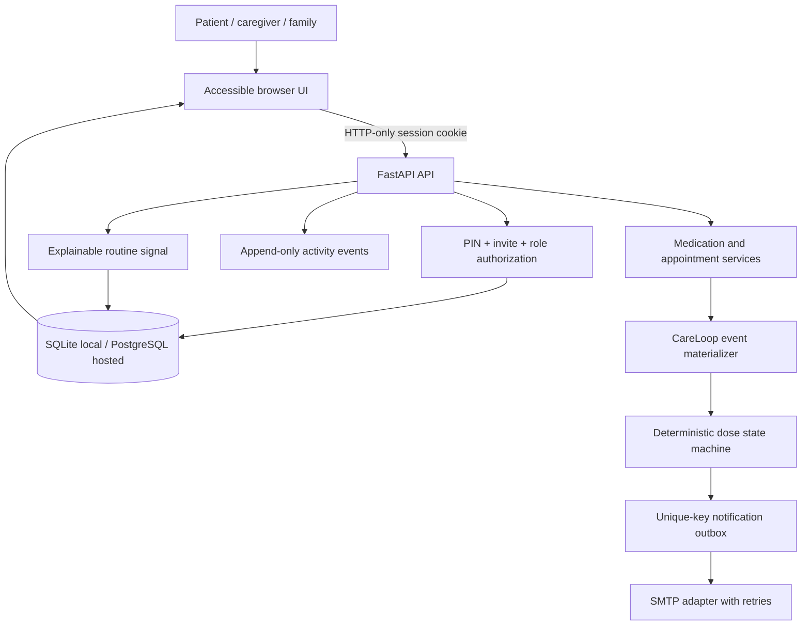

# Architecture and data flow

## Important transformations

1. **Identity:** profile code + member PIN → scrypt verification → random 256-bit session token → SHA-256 token digest stored server-side → HTTP-only cookie.
2. **Schedule:** profile timezone + local date + `HH:MM` values → timezone-aware local datetimes → UTC event timestamps. Events are unique on `(medication_id, scheduled_at)`.
3. **Dose state:** `pending` is materialized; `pending` becomes `taken` or `skipped` on a member action, or `missed` after 60 minutes without a check-in. Completed events cannot be silently overwritten.
4. **Reminder:** unique key includes event type and dose/appointment ID. One outbox record is created per active member email, or one in-app record if no email exists. SMTP retries are bounded to three attempts.
5. **Insight:** last 14 days of recorded events are grouped into morning/afternoon/evening/night. A signal appears only if at least four events exist in a period and at least 40% were not marked taken. The UI exposes the evidence and rule.

## Security boundaries

- Every data query is scoped by the active member's `profile_id`.
- Patient role alone can issue invitations. Caregiver can manage schedules and appointments. Family can read only.
- Invite code and PIN are hashed; session token is unguessable and server-side revocable.
- API uses no wildcard CORS; cookie is SameSite=Strict and HttpOnly; HTTPS deployment must enable Secure.
- Sensitive data is not sent to third-party LLM APIs. Email content is limited to notification context and should be sent only to members who explicitly supplied an address.

## Operational caveats

Run one app instance for this prototype because the scheduled worker is embedded in the service process. Hosted use should use Postgres. The provided Cloud Run recipe pins one warm instance with always-allocated CPU so the worker remains active; this incurs cost. A production design should move to a dedicated queue/Cloud Scheduler worker with distributed locks, monitoring, migration management and dead-letter handling.
